# 🐍 Python Learning Lab

<div align="center">

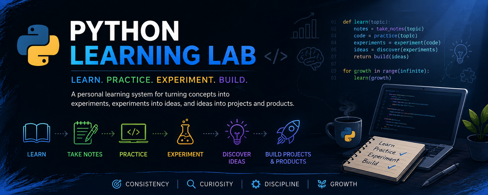

> A personal learning system for turning knowledge into practical skills, projects, and products.

[](https://www.python.org/)
[](https://jupyter.org/)
[](#)
[](#)

</div>

---

## 🧭 What Is This Repository?

This repository is the foundation behind my Python learning and projects. It brings together concept notes, code practice, and experiments in one organized place. Topics explored here can develop into stronger skills, project ideas, and real-world applications.

## 🎯 Purpose

- 📚 Learn concepts systematically
- 📝 Document knowledge through notes
- 💻 Reinforce understanding through code
- 🔬 Experiment beyond tutorials
- 🧠 Strengthen technical foundations
- 🚀 Generate ideas for projects and products
- 📈 Maintain consistent progress

---

## 🔄 The Learning-to-Build Pipeline

Each concept can move from study to practical application:

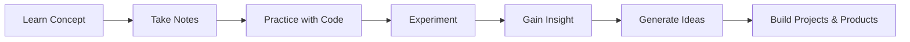

The aim is to apply concepts, experiment with them, and use the results to create something useful.

---

## 🏗️ Why This Repository Matters

This repository connects learning with building. Instead of asking only, "What did I learn today?", I also ask, "What can I build from what I learned?"

That mindset turns knowledge into a foundation for practical work.

## 🧠 Learning System

I choose topics according to my goals, knowledge gaps, and interests rather than following a fixed curriculum. Each learning cycle combines understanding with practical application.

### 🔄 Learning Cycle

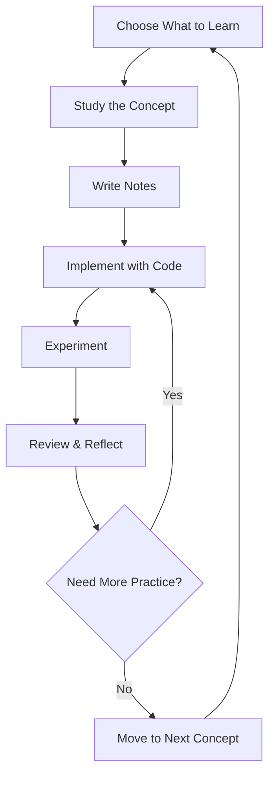

I aim to understand a concept well enough to explain it, implement it, and experiment with it.

---

### 📓 What Is a Learning Session?

A **learning session** is a focused unit of learning recorded in this repository. It includes both:

- 📝 **Notes** — what I learned and understood
- 💻 **Code** — a practical implementation or experiment

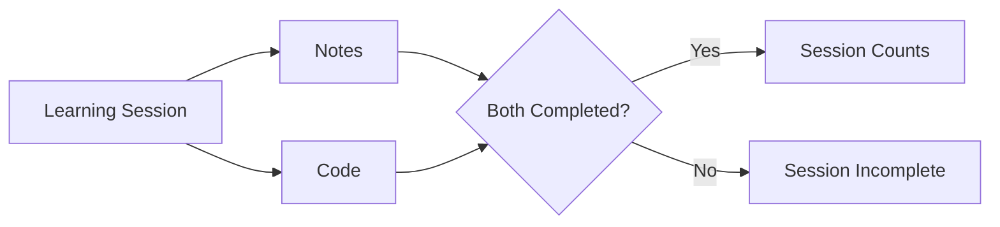

This measures meaningful learning rather than time spent studying.

---

## 🚀 From Learning to Building

Concepts and experiments can lead to larger projects and practical solutions.

### 🔗 The Connection

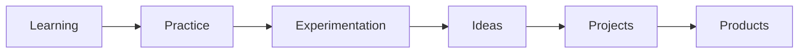

Building also reveals gaps in my knowledge, creating new topics to study and practice:

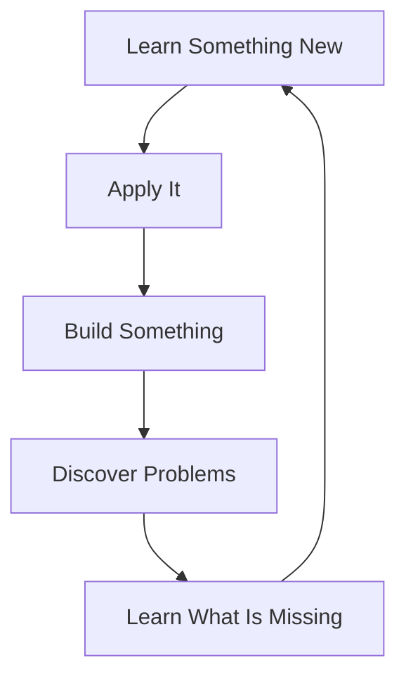

### 🏗️ Projects Built From This Foundation

| Learning Area | What I Practiced | What It Led To |
|---|---|---|
| 📦 Object-Oriented Programming | Classes, objects, composition, system design | [CLI E-Commerce Backend](#) |
| 📊 Data Analysis | Pandas, data cleaning, transformation, exploratory data analysis | [Superstore Sales Analysis](#) |
| 🤖 Generative AI | AI workflows, knowledge organization, RAG concepts | [Knowledge Publishing Assistant](#) |

These projects extend concepts first explored through learning and experimentation.

### 🧩 Example: OOP → E-Commerce Backend

My OOP practice covered classes, object relationships, composition, and system design. I applied these concepts to a CLI-based e-commerce backend.

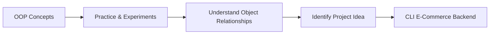

---

### 📊 Example: Data Analysis → Superstore Sales Analysis

I practiced data cleaning, transformation, aggregation, and analysis before applying these skills to a larger dataset in the **Superstore Sales Analysis** project.

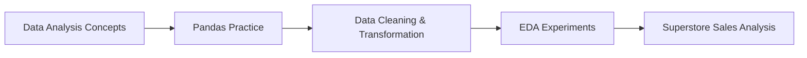

---

### 🤖 Example: Learning → Product Idea

Experiments with AI, knowledge organization, and content generation led to the idea for a **Knowledge Publishing Assistant**.

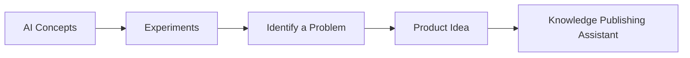

---

### 🌱 The Repository as a Project Incubator

Knowledge, experiments, and discovered problems can become project ideas and real-world applications. Projects are both practical outcomes of learning and starting points for further improvement.

## 📂 4. Repository

The repository is organized by learning area, with notes, implementations, and experiments grouped by subject.

### 🗂️ Repository Structure

```text
python-learning-lab/
│
├── core_python/
│   ├── 01_conditionals.ipynb
│   └── ...
│
├── OOP/
│   ├── 01_oop_basics.ipynb
│   └── ...
│
├── data_analysis/
│   ├── 01_numpy.ipynb
│   ├── 02_pandas.ipynb
│   ├── 03_data_cleaning.ipynb
│   └── ...
│
├── machine_learning/
│   ├── 01_classification.ipynb
│   └── ...
│
├── assets/
│   └── ...
│
├── requirements.txt
├── .gitignore
├── .LICENSE
└── README.md
```

The structure may change as new learning areas are added.

### 📚 Learning Areas

#### 🐍 Core Python

Fundamental and advanced concepts for building strong programming foundations.

- Variables and Data Types
- Operators
- Lists and Tuples
- Dictionaries and Sets
- Conditionals
- Loops
- Comprehensions
- Modules and Packages
- Functions and Recursion
- Procedural Programming
- Algorithms
- Functional Programming
- File I/O
- Exception Handling
- Iterators and Generators
- Testing and Debugging

#### 📦 Object-Oriented Programming

Designing and modeling software using objects.

- Classes and Objects
- Encapsulation
- Abstraction
- Decorators
- Getters and Setters
- Inheritance
- Polymorphism
- Aggregation and Composition
- Object Relationships
- Real-World System Design

#### 📊 Data Analysis

Transforming raw data into useful insights.

- NumPy
- Pandas
- Data Cleaning
- Data Transformation
- Exploratory Data Analysis
- Data Analysis
- Data Visualization

#### 🤖 Machine Learning

Foundations for understanding and developing machine learning systems.

- Scikit-Learn
- Data Preprocessing
- Data Balancing
- Supervised ML
- Classification
- Regression
- Unsupervised ML
- Clustering
- Dimensionality Reduction
- Machine Learning Experiments

#### 🔮 Future Areas

Potential areas to explore as my skills progress:

- Deep Learning
- Neural Networks
- Computer Vision
- Natural Language Processing
- MLOps
- Advanced AI Applications

---

### 📓 What Each Learning Area Contains

Depending on the subject and session, a learning area may contain:

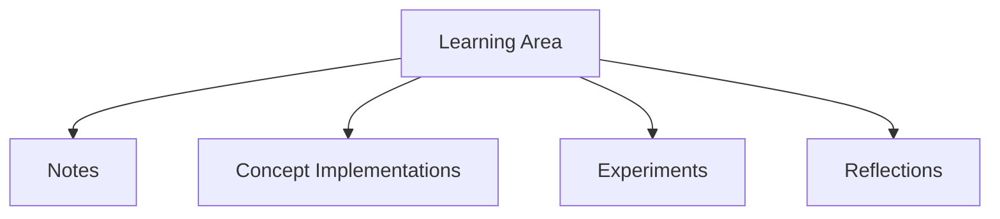

The focus is on understanding and experimentation, not perfectly polished code.

---

### 🔄 Continuous Evolution

New concepts, experiments, corrections, and learning areas will be added over time. Older notes may be revised, and some experiments may remain incomplete.

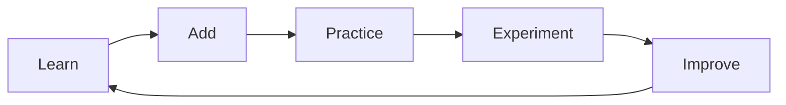

This repository documents an ongoing learning process rather than a finished course or software product.

---

## 🚀 Getting Started

Clone the repository:

```bash
git clone https://github.com/saad-sufyan-dev/python-practice.git
cd python-practice
```

Open it in your preferred editor or Jupyter environment. Most practice work is in Jupyter Notebooks (`.ipynb`), so Jupyter Notebook, JupyterLab, or VS Code with a suitable Python environment is recommended.

> This is primarily a learning resource, not a single application to install or run.

---

## 📦 Requirements

The repository uses the following Python libraries:

```text
pandas
numpy
matplotlib
seaborn
jupyter
scikit-learn==1.3.2
imbalanced-learn==0.11.0
...
```

Install the dependencies with:

```bash
pip install -r requirements.txt
```

## 🤝 Contributing

This is a personal learning repository, but constructive feedback is welcome. If you notice an incorrect explanation, technical mistake, better approach, useful resource, or concept worth exploring, open an **Issue** or submit a **Pull Request**.

---

## 📜 License

This project is licensed under the **MIT License**.

See the [`LICENSE`](LICENSE) file for complete details.

---

## ⭐ Support the Journey

If you find this repository useful, consider giving it a **star** on GitHub. It helps others discover the project and supports my continued learning and experimentation.

---

## 👤 About Me

Hi, I'm **Saad Sufyan**, a student and aspiring data professional interested in **Python, Data Analysis, Machine Learning, and Artificial Intelligence**.

I use this repository to document concepts, practice code, experiment with ideas, and develop projects.

> **Learn continuously, build deliberately, and turn knowledge into something useful.**

Find more of my work on GitHub: [saad-sufyan-dev](https://github.com/saad-sufyan-dev)

---

## 📌 A Note About This Repository

This repository is a work in progress. You may encounter:

- Incomplete experiments
- Rough implementations
- Mistakes and corrections
- Evolving notes
- Multiple approaches to the same problem

These are part of the learning process. The repository will continue to evolve as I learn, experiment, and build.
